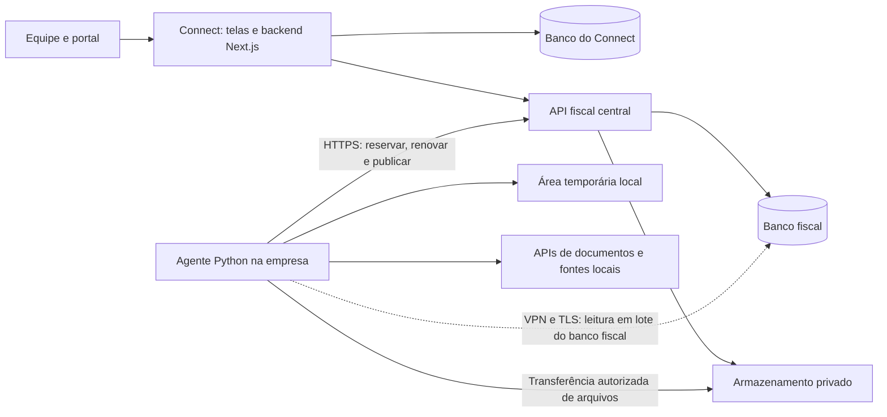

# Plano de implementação do backend Fiscal e SPED

Data: 13/10/2026. Estado: proposta histórica, substituída em 14/10 pelo plano alinhado em `PLANO-BACKEND-FISCAL-SPED.md`. Não usar este documento como roteiro de execução.

## 1. Premissas e decisões

Confirmado com o usuário:

- O motor de processamento rodará em uma máquina dentro da empresa.
- O Connect atende aproximadamente 400 empresas; inicialmente uma parcela delas usará SPED.
- A localização definitiva do acervo de XMLs, PDFs e arquivos gerados ainda não foi decidida.

Recomendação para o plano:

- Reaproveitar o motor Python, depois de generalizar seus cadastros, consultas e contratos.
- O Connect será a interface de operação, autenticação, permissões e acompanhamento.
- Uma API fiscal central persistirá tarefas, decisões, versões e resultados. O agente local consumirá a fila e executará o motor.
- Começar com fila durável no banco fiscal e um agente, sem adicionar Redis ou outro broker no primeiro ciclo.
- Manter o cadastro de empresas no Connect e o domínio de processamento no backend fiscal. O Connect continuará acessando o banco fiscal por API, conforme a separação já existente.
- Usar uma abstração de armazenamento. Preservar inicialmente o acesso aos blobs comprimidos existentes; escolher o destino dos novos arquivos grandes após medir volume, custo e operação.
- Liberar o processamento por empresa e obrigação homologada. As 400 empresas cadastradas não significam 400 gerações simultâneas nem suporte tributário imediato a todos os regimes.

A máquina local executa tarefas. Banco, fila e acervo definitivo precisam ter persistência própria e sobreviver à perda dessa máquina. Se o acervo ficar em NAS, essa persistência será local e exigirá backup externo e um caminho autenticado de acesso pelo Connect.

## 2. O que já existe e o que precisa mudar

| Área | Evidência no código | Consequência para a implementação |
|---|---|---|
| Connect | Next.js 16.2.9, Prisma 7 e adapter MariaDB | Reutilizar a estrutura existente; não trocar o banco do Connect para implementar Fiscal. Confirmar o servidor e a versão reais antes das migrations. |
| Novas telas fiscais | `src/lib/fiscal/previa/cenario.ts` e `ContextoFiscal.tsx` | Persistência atual em `localStorage`, com dados fictícios. Substituir por serviços e consultas reais; não migrar o cenário de teste como dado fiscal. |
| Acervo integrado | `FiscalDocument`, `src/lib/fiscal/*`, `src/lib/sped/*` | Já possui deduplicação por escritório, acesso de equipe/portal e integração com financeiro. Preservar esse contrato. |
| Integração SPED | `src/lib/sped/client.ts` e `credenciais.ts` | O Connect não acessa o MySQL do SPED. Credenciais vêm de integração habilitada por escritório; não há fallback global de ambiente. |
| Permissões | `src/lib/auth/modulo.ts` e `src/lib/fiscal/alcance.ts` | Aplicar as mesmas fronteiras nas leituras, comandos, downloads e acompanhamento de tarefas. |
| Cadastro | `Company`, `ClientGroup`, `parentCompanyId` | `Company` já representa CNPJs/estabelecimentos. `ClientGroup` pode reunir várias raízes; não equivale automaticamente à pessoa jurídica de uma obrigação. |
| Motor | `pipeline.py`, `pipeline_contribuicoes.py`, parsers, apurações e validadores | Reaproveitar a lógica homologada com adaptadores; cálculo e regras continuam em Python. |
| Fila atual | `execucoes_fila.py`, `agente.py`, funções de fila em `db.py` | Já existe reserva atômica de um pedido. Faltam lease renovável, recuperação automática após queda abrupta e proteção das publicações de tentativas antigas. |
| Contribuições | `CONFIGS`, receitas e saldos em arquivos específicos no pipeline | Há dependência explícita das filiais BLD e de dados de 2025. Isso impede tratar o motor atual como genérico para todas as empresas. |
| Consultas do motor | Listagens e classificações sem contexto obrigatório em vários helpers | Revisar escopo por escritório, contribuinte, estabelecimento e período; um filtro no endpoint não protege uma consulta global do motor. |
| Upload | `webapp/routers/upload.py`, `ingestao.py` | Upload atual é síncrono e acumula bytes em memória. Tornar ingestão assíncrona e leitura/descompactação em fluxo. |
| Arquivos | `xml_raw`, compressão com dicionário, `speds_gerados.conteudo` | Já há armazenamento central comprimido. Não fazer uma migração de todos os binários antes de ter o fluxo funcional. |
| Dinheiro | `Decimal` no acervo Connect; uso de `float` no motor | Definir precisão e arredondamento e homologar a mudança para `Decimal` por etapa. Não basta trocar o tipo de coluna. |
| Auditoria | `src/lib/audit.ts` | O log do Connect é best-effort. Fechamento, decisões fiscais e publicação precisam de auditoria obrigatória na transação fiscal. |
| Token atual | `webapp/app.py` | O token de integração só autoriza GET sob `/api/integracao/`. Criar um protocolo novo de escrita; não ampliar silenciosamente o token existente. |

Os comentários do repositório registram cenários com centenas de milhares de linhas no acervo e milhões de CT-e por mês. São evidências históricas de dimensionamento, não medições realizadas nesta análise. O piloto deve medir seus próprios dados.

## 3. Arquitetura proposta

O diagrama assume armazenamento central para mostrar a recomendação. Se o destino for NAS, a camada de armazenamento muda de implantação e o acesso remoto passa por um conector local autenticado; o domínio e o protocolo de tarefas permanecem iguais.

### Responsabilidade e fonte da verdade

| Componente | Responsabilidade | Fonte da verdade |
|---|---|---|
| Connect | Usuários, escritório ativo, setores, módulos, planos, cadastro de clientes/empresas, interface | Banco do Connect |
| API fiscal | Cadastro fiscal espelhado e versionado, documentos de processamento, decisões, parâmetros, tarefas, snapshots, arquivos, validações, entregas | Banco fiscal |
| Agente local | Extração, importação, OCR quando habilitado, apuração, geração, pré-validação e relatórios | Resultados publicados e aceitos pela API fiscal |
| Armazenamento | Conteúdo original, anexos, arquivos gerados, recibos, relatórios e logs completos | Referências e hashes registrados no banco fiscal |
| Acervo `FiscalDocument` | Projeção para os usos já existentes no Connect e financeiro | Documento de origem no fiscal; destino financeiro continua pertencendo ao Connect |

O estado da fila não fica na memória do Next.js nem em arquivo local. A API registra o pedido e responde rapidamente com seu identificador. O motor roda no agente da empresa. A separação de trabalho pesado do processo HTTP também é coerente com a orientação do [FastAPI para tarefas pesadas](https://fastapi.tiangolo.com/tutorial/background-tasks/).

### Comunicação com a máquina da empresa

1. O agente inicia sem depender de alguém abrir o painel e autentica com credencial própria da instalação.
2. Busca trabalho por conexão de saída HTTPS e informa capacidades e versão.
3. Reserva uma tarefa, recebe seu escopo e uma autorização temporária para aquela tentativa.
4. Lê os insumos, processa e envia progresso, logs e resultados em lotes.
5. A API verifica a tentativa, a revisão dos insumos e os arquivos antes de aceitar a publicação.

Não é necessário abrir uma porta pública de controle na máquina da empresa. Para reaproveitar as leituras SQL em lote do motor, o plano inicial prevê VPN de saída e TLS para o banco fiscal próprio, sem expor SQL na internet. O agente não recebe credencial do banco do Connect.

A instalação só recebe acesso aos bancos fiscais dos escritórios autorizados. No primeiro piloto, usar um banco fiscal isolado para o escritório atendido. Para outros escritórios, preferir bancos/credenciais separados enquanto os repositórios não estiverem homologados para compartilhamento. `tenantId` continua obrigatório no contrato e nas entidades de controle. Não conceder a uma instalação local acesso SQL a dados de escritórios que ela não atende.

Leituras SQL devem passar por um repositório com contexto obrigatório. Escritas de documentos importados, estado de execução, saldos e resultados passam pelos endpoints de ingestão/publicação com verificação da tentativa. Isso exige retirar essas escritas dos helpers globais do pipeline. Se a VPN não for viável, implementar um repositório por API com páginas comprimidas e cache local; não transformar cada consulta ou documento em uma requisição HTTP individual.

## 4. Escopo fiscal e cadastros

O contexto mínimo de qualquer operação será:

- `tenantId`: escritório, obtido da sessão ou da credencial de agente.
- `taxpayerId`: pessoa jurídica contribuinte, distinta do agrupamento comercial `ClientGroup`.
- `companyId`: estabelecimento do Connect, quando a obrigação exige esse escopo.
- `competence`: `AAAA-MM` validado.
- `obligation`: obrigação e versão de contrato.
- `actorId`, `requestId` e revisão esperada para escritas.

O backend resolve a relação entre os identificadores; não aceita um CNPJ da URL como prova de autorização. Um estabelecimento precisa pertencer ao escritório e à pessoa jurídica selecionados. A escolha de uma holding no Connect não pode consolidar automaticamente obrigações de raízes diferentes.

| Obrigação | Escopo de processamento |
|---|---|
| EFD ICMS/IPI | Estabelecimento e competência; UF, inscrição e perfil fiscal aplicáveis |
| EFD Contribuições | Pessoa jurídica e competência; emissão centralizada pela matriz e insumos dos estabelecimentos pertinentes |
| Obrigações estaduais | Estabelecimento, UF, competência e obrigação específica homologada |

O arquivo centralizado de Contribuições é confirmado pela [Receita Federal](https://www.gov.br/receitafederal/pt-br/acesso-a-informacao/perguntas-frequentes/sped/efd-contribuicoes/efdc/a-efd-contribuicoes-deve-ser-entregue). A identificação por estabelecimento da EFD ICMS/IPI deve seguir o [Guia Prático publicado no SPED](https://sped.rfb.gov.br/arquivo/download/8112). A cobertura concreta de registros, regimes e obrigações estaduais será uma matriz de homologação, não uma suposição baseada no nome do módulo.

### Cadastro e vigência

- Espelhar do Connect identificadores, CNPJ, matriz/filial, UF, inscrições e dados cadastrais necessários. O espelho fiscal não oferece edição concorrente do cadastro geral.
- Complementar com parâmetros fiscais específicos, responsável, perfil, datas de vigência e obrigação habilitada.
- Resolver matriz e estabelecimentos por cadastro e vínculo confirmado; substituir a lista fixa de arquivos BLD do pipeline.
- Substituir receitas, saldos e recibos vindos de arquivos específicos por parâmetros versionados da pessoa jurídica/competência.
- Preservar o cadastro utilizado em uma geração, mesmo que a empresa mude depois.
- Empresa sem identificação ou configuração suficiente fica impedida com motivo específico. Ausência de dados nunca significa consultar todas as empresas.

### Compatibilidade com CNPJ alfanumérico

O código atual remove caracteres não numéricos em diversos caminhos. Isso precisa entrar no levantamento de compatibilidade: a Receita já anunciou a primeira inscrição alfanumérica em julho de 2026. O novo domínio deve armazenar identificação como texto normalizado, preservar letras, manter validação numérica para CPF e escolher validação de CNPJ conforme o formato. [Fonte oficial](https://www.gov.br/fazenda/pt-br/assuntos/noticias/2026/julho/receita-federal-gera-o-primeiro-cnpj-em-formato-alfanumerico).

Auditar máscaras, busca, raiz, deduplicação, parsers, contratos e restrições de chaves. Não alterar a interpretação de uma chave fiscal por analogia: cada modelo/leiaute precisa de suporte confirmado. Um formato ainda não suportado deve ser preservado e sinalizado para tratamento, nunca transformado removendo letras. A correção dos helpers compartilhados do Connect terá testes próprios e implantação controlada.

## 5. Modelo de dados

Os nomes abaixo são entidades propostas, não DDL pronto. As migrations finais devem respeitar as tabelas existentes e preservar seus identificadores legados.

| Grupo | Entidades | Conteúdo principal |
|---|---|---|
| Vínculos | `FiscalTaxpayer`, `FiscalEstablishment`, `FiscalScopeMapping` | Escritório, contribuinte, estabelecimento, IDs Connect/legado, matriz e cadastro versionado |
| Competências | `FiscalPeriod`, `FiscalObligationPeriod` | Período, obrigação, revisão atual, fechamento vigente, bloqueios e resumo operacional |
| Agentes | `ProcessingAgent`, `AgentGrant`, `AgentHeartbeat` | Instalação, escritórios autorizados, capacidades, versão, último contato e estado |
| Processamento | `ProcessingJob`, `JobAttempt`, `JobEvent`, `ScopeLease` | Pedido, tentativa, reserva, fencing token, progresso, checkpoint, erros e cancelamento |
| Envios | `UploadSession`, `ImportBatch`, `ImportItem` | Arquivo recebido, origem, autor, estados por item, contadores e vínculo ao documento |
| Documentos | `FiscalSourceDocument`, `FiscalSourceVersion`, `DocumentScope`, `FiscalDocumentItem`, `DocumentEvent` | Identidade canônica, versões do original, participação por estabelecimento, itens e eventos de cancelamento/substituição |
| Quarentena | `QuarantineItem`, `QuarantineResolution` | Original preservado, motivo tipado, parser usado, resolução, autor e reprocessamentos |
| Decisões | `ClassificationDecision`, `RecordDecision`, `SupportDocumentDecision` | Destinação/crédito, vigência, justificativa, antes/depois e autor |
| Parâmetros | `FiscalParameterRevision`, `FiscalAdjustment`, `RuleBundle` | Valores, vigência, ajuste, obrigação e versão das regras publicadas pelo código |
| Fechamento | `CoverageSnapshot`, `CalculationRun`, `CalculationSummary`, `ClosureSnapshot` | Cobertura, cálculo, evidências, referências aos insumos e fechamento imutável |
| Arquivos | `GeneratedFile`, `FileArtifact`, `ValidationRun`, `ValidationIssue` | Versão, conteúdo/hash, execução, relatório, severidade e localização do erro |
| Entrega | `DeliveryRecord`, `DeliveryEvidence` | Arquivo exato, recibo/protocolo, evidência, responsável e eventuais retificações |
| Conferência | `ReconciliationRun`, `ReconciliationItem`, `ReconciliationDecision` | Bases comparadas, diferenças e decisões de conferência |
| Integração | `FiscalOutboxEvent`, `ConsumerCheckpoint`, `FiscalAuditEvent` | Eventos duráveis, projeção no Connect e auditoria transacional |

No Connect, adicionar somente os vínculos e checkpoints necessários para consumir o backend fiscal. Reaproveitar `TenantIntegration`, `SpedSyncState`, `Company`, `ClientGroup`, `AuditLog` e `FiscalDocument` onde seus contratos correspondem. Não duplicar todas as tabelas do motor em Prisma apenas para alimentar as novas telas.

### Identidade, valores e índices

- Documento físico: identidade por escritório, tipo e chave canônica. Versão do conteúdo: hash e revisão. Mesma chave com conteúdo diferente exige verificar atualização/evento ou conflito; não é descarte automático de bytes.
- Participação: um documento pode interessar a mais de um estabelecimento. `DocumentScope` registra papel/sentido; isso não duplica o original nem autoriza dupla contagem na consolidação.
- NFS-e sem chave nacional: chave composta versionada por prestador, série, número e atributos necessários ao modelo municipal. Harmonizar com a chave atual do Connect antes do backfill.
- PDF/imagem: hash detecta arquivo idêntico. Recibos de digitalizações distintas exigem identidade de negócio ou decisão humana; nome de arquivo não é identidade.
- Valores financeiros e bases usam decimal exato; escala de valores, quantidades e alíquotas será especificada por campo/leiaute. No JSON, decimais viajam como strings. `null` preserva valor desconhecido.
- `competence` é mês de referência, não instante. Data de emissão, rota, prestação e pagamento são campos separados.
- Instantes de execução/auditoria são UTC com fuso explícito; exibição usa o fuso do escritório.
- Índices devem começar pelo escritório/escopo da consulta: documentos por período e ID, fila por disponibilidade, eventos por sequência, decisões por vigência, arquivos por obrigação/competência/versão.
- Aplicar uniques no banco para idempotência e deduplicação. Relações entre entidades devem verificar o mesmo escritório; incluir chaves compostas onde houver banco compartilhado.
- Listagens grandes usam cursor estável com desempate por ID; não usar `OFFSET` crescente para milhões de documentos.

## 6. Fluxo de documentos e importações

1. Connect autentica o autor, valida módulo, empresa e quota e solicita uma sessão de upload.
2. O arquivo é recebido em área privada temporária, em fluxo ou por upload direto autorizado. Um ZIP grande não atravessa uma Server Action nem depende do limite atual do proxy do Connect.
3. O backend confirma tamanho, integridade e término do envio; só então disponibiliza a importação ao agente.
4. O agente enumera o lote, identifica o formato e trata XMLs, eventos, CSVs, PDFs e imagens com os parsers pertinentes.
5. Cada item tem resultado independente: aceito, duplicado, atualizado, em quarentena ou recusado por política de formato.
6. Publicar documentos em lotes limitados, com chave de idempotência e checkpoint transacional. Retomar não soma contadores nem cria itens novamente.
7. Finalizar o lote com contadores reconciliáveis e relatório detalhado. Uma falha parcial não apaga os itens já publicados.

Itens fora da empresa selecionada ficam em quarentena ou seguem roteamento explícito para empresas autorizadas do mesmo escritório, conforme a modalidade do envio. Não associar documentos por aproximação de nome nem mudar seu estabelecimento silenciosamente.

### Limites de leitura

Definir limites configuráveis de bytes enviados e descompactados, número de itens, profundidade, razão de compressão, páginas/imagens, tempo de parser e espaço temporário. Verificar esses limites durante a leitura, não apenas depois de extrair. Bloquear travessia de diretórios, links e entidades XML externas. Um arquivo problemático terá identificação e motivo no relatório.

### Cobertura e extração

- Registrar fonte, período solicitado, cursor da fonte, total conhecido quando disponível, documentos recebidos, faltantes e última atualização.
- Não chamar uma competência de completa porque uma execução terminou sem erro técnico.
- Rate limit é por credencial/provedor; usar backoff com variação aleatória e respeitar a sinalização da fonte.
- Agendar extrações por empresa/período com checkpoints. O agente pode acessar pasta/NAS local autorizado, sem aceitar caminhos arbitrários enviados pelo navegador.
- Preservar origem, ator e momento de cada documento e evento. OCR extrai uma sugestão; dados ambíguos exigem decisão antes de entrar nos totais.

## 7. Classificação, regras e parâmetros

Regras fiscais continuam no código do motor e em pacotes de configuração versionados. A tela Regras fiscais consulta regra, tratamento, fonte/procedência, vigência e versão; não oferece edição de lógica tributária pelo usuário.

Decisões operacionais são dados persistidos: destinação de produto, aproveitamento de crédito, aprovação de documento de apoio, decisões por registro e ajustes. Cada decisão informa escopo, vigência, motivo, ator e revisão substituída. Uma classificação global por fornecedor/produto não pode contaminar outro contribuinte quando o tratamento depende do destinatário ou período.

Escritas usam revisão esperada (`expectedRevision`/`If-Match`). A API responde conflito se outra pessoa alterou a base; não sobrescreve silenciosamente a decisão recente. Operações em lote têm chave de idempotência e relatório por item.

Mudanças relevantes incrementam a revisão fiscal e invalidam cálculos/fechamentos dependentes. Manter saldos transportados com vínculo à apuração de origem; retificar um mês sinaliza os meses seguintes afetados, sem reescrever entregas históricas.

## 8. Apuração, fechamento e reprodução

Estados de trabalho de uma obrigação/competência:

`ABERTA → EM_APURACAO → APURADA → EM_FECHAMENTO → FECHADA`

O fechamento pertence a um snapshot, não é um booleano que torna qualquer arquivo daquele mês atual. Reabertura registra motivo, autor e nova revisão, preservando o fechamento anterior. Artefatos e entregas têm estados próprios.

O snapshot registra:

- Documentos, versões e eventos considerados; decisões e suas revisões.
- Estabelecimentos e versão cadastral usados.
- Parâmetros, ajustes, cobertura e exceções justificadas.
- Saldo anterior e apuração/fechamento de origem.
- Versão do motor, pacote de regras, tabelas e leiaute aplicáveis à competência.
- Autor, instante, revisão de corte e hash do manifesto.

Para volumes grandes, preservar versões imutáveis e um corte de sequência de alterações confirmadas. O manifesto pode ser construído em fluxo sobre esse corte. Um timestamp isolado ou uma leitura do estado corrente durante toda a geração não reproduz a base de um fechamento.

A captura do corte e a confirmação de revisões precisam ser transacionais. Se houver sequência por escritório, sua atribuição e commit devem garantir que uma alteração ainda não confirmada não apareça posteriormente abaixo do corte. Não manter uma transação longa de geração aberta nem bloquear toda a operação por minutos.

Apuração e fechamento devem distinguir impedimentos de avisos e exceções autorizadas. Cobertura insuficiente ou decisão obrigatória pendente impede fechar. Quando a regra permitir exceção, ela exige motivo e permissão apropriada, registrados no snapshot.

Ao publicar resultado calculado sobre revisão antiga, conservar a evidência e marcá-lo desatualizado. Não promover esse resultado a apuração vigente nem liberar entrega sem tratamento.

## 9. Fila durável e protocolo do agente

### Tipos de tarefa

`IMPORTAR_LOTE`, `EXTRAIR_DOCUMENTOS`, `REPROCESSAR_QUARENTENA`, `APURAR`, `FECHAR_COMPETENCIA`, `GERAR_EFD_ICMS_IPI`, `GERAR_EFD_CONTRIBUICOES`, `VALIDAR_ARQUIVO`, `GERAR_OBRIGACAO_ESTADUAL`, `CONFERIR_DOCUMENTOS` e `EXPORTAR_RELATORIO`.

Cada tipo tem schema de parâmetros, capacidades necessárias, timeout por etapa, política de retry e critério de conclusão. Nenhum pedido contém um comando shell livre ou caminho de saída definido pelo navegador.

Estados de tarefa:

`AGUARDANDO → RESERVADA → EXECUTANDO → PUBLICANDO → CONCLUIDA`

Saídas alternativas: `AGUARDANDO_RETRY`, `AGUARDANDO_DECISAO`, `FALHOU`, `CANCELAMENTO_SOLICITADO`, `CANCELADA`. A disponibilidade do agente é um estado separado.

### Reserva e concorrência

- A API reserva tarefa em transação curta e cria uma tentativa com `agentId`, `leaseExpiresAt` e fencing token crescente.
- A fila filtra escritórios autorizados, capacidades e versão mínima do agente antes de reservar.
- A chave de idempotência identifica a requisição do usuário; a equivalência de trabalho considera ação, escopo, parâmetros e snapshot. Cliques repetidos retornam o mesmo pedido.
- Um lock de escopo protege publicação/fechamento da mesma obrigação e competência. A consolidação de Contribuições precisa considerar os estabelecimentos dependentes, não apenas a filial selecionada.
- Se o banco instalado suportar, usar `FOR UPDATE SKIP LOCKED` em InnoDB. Caso contrário, usar reserva por update condicional e token único, expandindo a técnica já usada no legado. A [documentação MariaDB](https://mariadb.com/docs/server/reference/sql-statements/data-manipulation/selecting-data/select) informa a dependência de versão e engine; confirmar isso antes de definir o SQL final.
- Começar com uma tarefa pesada de cálculo/geração por máquina. Dimensionar importação/extração separadamente por memória e rate limit; não ligar dezenas de workers pela quantidade de empresas.
- Distribuir a fila por escritório/contribuinte para evitar que um cliente de grande volume monopolize todo o processamento.

### Heartbeat, queda de conexão e retry

Como parâmetros iniciais de piloto: consulta de fila a cada 5–10 segundos, heartbeat da tentativa a cada 15 segundos e lease de 90 segundos. São configurações ajustáveis; a renovação ocorre no supervisor, independentemente do subprocesso pesado.

Se a internet cair ou a máquina desligar, a tarefa fica com a última etapa/checkpoint conhecido. Ao expirar o lease, o reconciliador pode liberar nova tentativa conforme sua política. O agente antigo perde autorização para publicar. A tela distingue máquina offline de erro fiscal.

Toda escrita ligada à tarefa verifica fencing token, tentativa e validade da reserva dentro da transação. Resultados e uploads de uma tentativa vencida ficam temporários; não alteram documentos, saldos, fechamento ou versão corrente. A credencial SQL do agente serve às leituras autorizadas e não permite contornar essa publicação.

O protocolo assume execução pelo menos uma vez. Uniques, checkpoints e commit condicionado tornam idempotentes os efeitos aceitos. Não prometer execução exatamente uma vez apenas por existir um lock.

Retry automático serve a falhas transitórias de rede, banco e fontes. Erro de configuração, regra, documento inválido ou falta de recibo anterior exige decisão/configuração. Limitar tentativas e preservar seu histórico.

### Publicação e cancelamento

1. O agente produz conteúdo em diretório isolado por tarefa/tentativa.
2. Envia os artefatos para área temporária e informa tamanho, hash e manifesto.
3. A API confirma integridade, escopo, snapshot e reserva.
4. Uma transação registra artefato, resumo, auditoria, outbox e conclusão. Se houver armazenamento externo, a transação só referencia conteúdo já confirmado; reconciliação trata objetos órfãos e publicações interrompidas.
5. Repetir a conclusão com o mesmo resultado devolve a publicação já aceita. Resultado divergente para a mesma chave gera conflito explícito.

Cancelamento pendente é imediato. Durante execução, o supervisor solicita parada segura, encerra o subprocesso se necessário e mantém o histórico. Uma etapa com efeito já confirmado não é desfeita implicitamente. Corrida entre cancelamento e conclusão é resolvida por transição condicional no servidor.

Sucesso requer os artefatos e contadores esperados, além do código de saída. O legado registra um incidente em que um comando terminou com código zero sem extrair documentos; esse caso deve virar teste do protocolo.

## 10. Armazenamento de conteúdo

### Separação obrigatória

| Classe | Conteúdo | Política |
|---|---|---|
| Original | XMLs, eventos, PDFs, imagens, arquivos de origem | Preservar bytes e procedência; correções geram nova revisão/dado derivado |
| Derivado | Itens normalizados, OCR, demonstrativos e cálculos | Referência ao original, parser/motor e revisão |
| Fiscal gerado | TXT, anexos de validação, recibos e evidências | Arquivo imutável vinculado ao snapshot e à versão |
| Temporário | Upload incompleto, extração, cache e saída ainda não publicada | Quota, validade e limpeza; nunca única cópia de resultado aceito |

Interface proposta `BinaryStore`: iniciar envio, confirmar integridade, abrir stream, consultar metadados, autorizar download e eliminar temporário. A entidade guarda `storageBackend`, chave opaca, tamanho, hash, codec e eventual versão do objeto; não guarda uma URL pública permanente.

### Escolha ainda pendente

| Opção | Quando faz sentido | Condição operacional |
|---|---|---|
| Blobs comprimidos no banco fiscal existente | Preservar o acervo atual e colocar o piloto em funcionamento | Medir crescimento, backup, streaming e limites de memória/conexão; preservar dicionários de compressão |
| Volume privado central | Uploads e arquivos do piloto, com operação simples | Volume persistente fora da imagem, quota, backup externo e acesso só por endpoint autorizado |
| Object storage privado compatível com S3 | Crescimento do acervo e transferência direta de arquivos grandes | Avaliar custos de operações/tráfego, integridade, multipart, versionamento e compatibilidade real do provedor |
| NAS/servidor da empresa | Aproveitar infraestrutura e política interna de dados | Conector autenticado para o Connect, disponibilidade local, backup externo e definição do comportamento offline |

Recomendação: acervo acessível centralmente pelo Connect e cache temporário local. Não escolher fornecedor ou mover milhões de XMLs agora. O piloto pode manter o driver de blobs legados e, se houver infraestrutura disponível, um volume central privado para os novos uploads. A escolha final deve ocorrer antes de expandir o volume.

Para XMLs numerosos e pequenos, comparar blobs comprimidos, objetos individuais e pacotes indexados por lote. Um objeto por XML pode elevar operações e overhead; um pacote grande pode piorar leitura unitária e recuperação. A escolha deve usar bytes comprimidos, tempo de acesso, taxa de operações e custo medidos.

Compressão precisa ser reversível byte a byte. Arquivar codec, versão e dicionários utilizados com hashes e backup. Não excluir dicionário enquanto houver conteúdo dependente. O hash de referência representa os bytes originais ou, para o TXT gerado, os bytes exatos entregáveis.

### Upload/download e integridade

- Chaves são geradas no servidor e incluem separação de escritório e objeto; nunca derivam de um caminho fornecido pelo usuário.
- Arquivos grandes usam transferência em fluxo ou multipart retomável. Confirmar quotas/tamanho no servidor, mesmo quando houver envio direto.
- URLs assinadas têm prazo curto e escopo restrito. No S3, elas podem ser reutilizadas até expirar e sobrescrever uma chave existente; por isso envio temporário e promoção imutável são etapas diferentes. [Documentação AWS](https://docs.aws.amazon.com/AmazonS3/latest/userguide/using-presigned-url.html).
- Para um provedor que suporte, usar escrita condicional na chave final; caso contrário, novas chaves e controle de publicação/versionamento oferecem a proteção necessária. Testar a compatibilidade, não presumir igualdade com S3. [Escritas condicionais](https://docs.aws.amazon.com/AmazonS3/latest/userguide/conditional-writes.html).
- Confirmar checksum com o mecanismo suportado; não usar ETag multipart como se fosse SHA-256 do arquivo. [Multipart e checksums](https://docs.aws.amazon.com/AmazonS3/latest/userguide/mpuoverview.html).
- Downloads verificam acesso antes de autorizar a transferência; o link temporário é uma credencial e não deve aparecer em logs.
- Limpeza de uploads incompletos e objetos órfãos respeita reservas ativas, publicações em andamento e referências existentes.
- Exclusão definitiva segue política confirmada de retenção fiscal e privacidade; não codificar um prazo universal apenas para liberar disco.

## 11. Geração, validação e entrega

### Versões

Cada geração recebe número sequencial único por escritório, contribuinte/estabelecimento, obrigação e competência. Reservar o número em transação; falhas podem deixar lacunas. Uma nova geração nunca sobrescreve os bytes da anterior.

Registrar snapshot, hash do TXT, motor, regra, leiaute, parâmetros, contadores, finalidade original/retificadora e execução. A revisão vigente é um vínculo explícito. Mudança posterior nos insumos sinaliza revisão necessária e preserva o histórico do arquivo entregue.

Leiaute e tabelas devem ser selecionados pela competência, conforme os requisitos da obrigação. Não fixar a versão atual para toda competência histórica. A versão do programa oficial de validação/transmissão também deve ficar registrada na evidência correspondente.

### Três marcos distintos

| Marco | O que prova | Como registrar |
|---|---|---|
| Pré-validação interna | Verificações implementadas no motor | Job de validação, versão do validador, arquivo/hash, erros e avisos |
| Validação no programa oficial | Importação/validação no programa aplicável | Evidência e versão do programa, responsável, data e hash do TXT utilizado |
| Entrega/transmissão | Protocolo/recibo da obrigação | Registro vinculado ao arquivo exato e ao comprovante, com conferência dos identificadores |

A interface não pode chamar uma pré-validação interna de aprovação oficial. Quando a evidência externa não puder ser verificada automaticamente, registrar sua natureza manual e responsável.

Entrega pertence a uma versão específica. Um recibo antigo não conclui um arquivo recém-gerado. Retificadora informa versão substituída e recibo anterior quando exigido pelo leiaute; requisitos e autorizações aplicáveis devem ser confirmados com a equipe fiscal para aquele período/UF.

No primeiro ciclo, implementar geração, pré-validação e registro de validação/entrega externa. Automação do programa oficial, assinatura e transmissão exige uma etapa própria de viabilidade, certificados e homologação. O fluxo atual das telas é o de arquivos próprios do Connect; não adicionar uma etapa de importação no Domínio.

## 12. Contratos de API

Criar contrato `/v1` e OpenAPI antes de ligar telas. As rotas abaixo são propostas para a API fiscal. O Connect expõe seus endpoints autenticados sob `/api/fiscal` e delega à camada de serviço; Server Components usam essa camada diretamente, sem chamar a própria API HTTP do Connect.

| Grupo | Operações propostas |
|---|---|
| Contexto | `GET /v1/scopes`, `PUT /v1/scopes/{id}/registration`, `GET /v1/periods/{id}/summary` |
| Upload | `POST /v1/uploads`, `POST /v1/uploads/{id}/complete`, `POST /v1/imports` |
| Documentos | `GET /v1/documents`, `GET /v1/documents/{id}`, `GET /v1/documents/{id}/content`, `GET /v1/imports/{id}/items` |
| Quarentena/cobertura | `GET /v1/quarantine`, `POST /v1/quarantine/{id}/reprocess`, `GET /v1/coverage` |
| Decisões | `POST /v1/classification-decisions`, `POST /v1/record-decisions`, `GET /v1/decisions/history` |
| Parâmetros/regras | `GET /v1/parameters`, `POST /v1/parameter-revisions`, `GET /v1/rules` |
| Apuração | `POST /v1/calculations`, `POST /v1/adjustments`, `GET /v1/calculations/{id}` |
| Fechamento | `POST /v1/closures`, `POST /v1/closures/{id}/reopen`, `GET /v1/snapshots/{id}` |
| Arquivos | `POST /v1/generations`, `GET /v1/files`, `GET /v1/files/{id}/download`, `POST /v1/files/{id}/validations` |
| Entregas | `POST /v1/files/{id}/official-validations`, `POST /v1/files/{id}/deliveries`, `GET /v1/deliveries` |
| Execuções | `GET /v1/jobs`, `GET /v1/jobs/{id}`, `GET /v1/jobs/{id}/events`, `POST /v1/jobs/{id}/cancel`, `POST /v1/jobs/{id}/retry` |
| Conferência | `POST /v1/reconciliations`, `GET /v1/reconciliations/{id}`, `POST /v1/reconciliations/{id}/decisions` |
| Agente | `POST /v1/agent/heartbeat`, `POST /v1/agent/jobs/claim`, `POST /v1/agent/jobs/{id}/renew`, `POST /v1/agent/jobs/{id}/events`, `POST /v1/agent/jobs/{id}/checkpoint`, `POST /v1/agent/jobs/{id}/publish` |
| Ingestão do agente | `POST /v1/agent/jobs/{id}/documents/batch`, `POST /v1/agent/jobs/{id}/artifacts`, `POST /v1/agent/jobs/{id}/failure` |
| Projeção Connect | `GET /v1/changes` com cursor opaco; confirmação de consumo persistida pelo consumidor |

### Regras do contrato

- Comandos longos retornam `202` com `jobId` e estado. Leituras paginadas retornam cursor e filtros aplicados.
- Escritas repetíveis recebem `Idempotency-Key`; alterações recebem revisão esperada. O servidor guarda fingerprint do corpo e rejeita a mesma chave com conteúdo diferente.
- Erro tem código estável, mensagem, `requestId`, indicação de retry e detalhes autorizados. Ex.: `scope_forbidden`, `revision_conflict`, `agent_unavailable`, `lease_expired`, `coverage_incomplete`, `source_conflict`, `unsupported_format` e `previous_receipt_required`.
- `401` para autenticação, `403`/`404` conforme política de acesso, `409` para conflito, `413` para tamanho, `422` para dados inválidos e `429` para limite de operação.
- Tenant, ator e permissões vêm da sessão/assertion autenticada do servidor, não de campos confiados ao navegador.
- Tokens do Connect e do agente são distintos, revogáveis, vinculados à instalação/escritório e à finalidade. Autorizações de job são curtas e ligadas à tentativa.
- O token legado de GET continua no contrato legado. Uma integração antiga não ganha permissão de execução automaticamente.
- Validar corpos e respostas no limite das aplicações. DTOs não transportam credenciais, caminhos reais, conteúdo bruto desnecessário nem dados de outro escopo.

Para evolução do Next.js, foram consultados os guias locais da versão instalada: Route Handlers, Data Security e Backend for Frontend. O plano mantém consultas fiscais sensíveis sem cache público/compartilhado entre escritórios; qualquer cache interno precisa incluir autorização, escopo e revisão.

## 13. Integração das telas e do acervo

| Tela atual | Backend necessário |
|---|---|
| Painel fiscal | Resumo por obrigação e escopo, bloqueios e próxima ação da versão vigente |
| Documentos e importações | Acervo do processamento, envio, progresso por lote, quarentena e cobertura |
| Classificação | Decisões individuais/em lote, revisão e histórico |
| ICMS e IPI | Apuração por estabelecimento, ajustes, demonstrativo e obrigações estaduais homologadas |
| PIS e COFINS | Base consolidada da pessoa jurídica, decisões, parâmetros, fechamento e geração |
| Arquivos e entregas | Arquivos imutáveis, validações distintas, evidências e entregas por versão |
| Execuções | Fila, tentativas, heartbeat do agente, progresso, erros e recuperação |
| Conferência fiscal | Comparações e decisões; criação de lançamento financeiro continua no módulo responsável |
| Configurações fiscais | Parâmetros versionados e consulta de regras/procedência |

Substituir o contexto de simulação por DTOs e comandos reais gradualmente, com feature flag por escritório/empresa. `localStorage` permanece apenas para preferências da interface, como favoritos; decisões e estados fiscais ficam no servidor.

No piloto, polling de status/eventos com cursor é suficiente: cerca de 5 segundos durante tarefa ativa, intervalo maior quando ocioso e pausa quando a tela não estiver visível. WebSocket/SSE pode ser acrescentado se houver benefício medido.

### Projeção no acervo existente

- Manter sincronização incremental com cursor opaco e desempate por documento, preservando remoções/eventos e retomada após falha.
- Registrar o evento de projeção na mesma transação da mudança fiscal; consumir pelo menos uma vez com idempotência.
- Não copiar todos os CT-e de processamento para `FiscalDocument`. Preservar a política atual de projeção seletiva e consulta própria para grandes volumes.
- Vínculo ao financeiro é local do Connect; reimportação não zera destino, decisão financeira ou lançamento existente.
- Corrigir documento no acervo Connect não muda o XML original. Definir quais correções operacionais serão enviadas ao fiscal como decisão versionada; divergência visível não pode virar regra implícita de cálculo.
- Durante migração, cada empresa/competência tem uma origem de escrita ativa. Comparação em paralelo pode ler ambos os caminhos; evitar dois pipelines gravando decisões e resultados concorrentes.

## 14. Segurança e auditoria

- Reutilizar `getAuthContext`, o gate do módulo, os níveis ver/agir/gerir e a verificação de alcance da empresa. Gate de página não substitui autorização do comando ou download.
- Operações de fechamento, reabertura, mudança de parâmetros, exceções e entrega exigem a permissão correspondente. O portal só recebe as operações explicitamente liberadas para seu alcance.
- Uma consolidação de pessoa jurídica requer acesso ao conjunto necessário. Permissão para uma filial não autoriza automaticamente ler dados das outras filiais no portal.
- A API fiscal verifica a identidade do chamador e o escopo autorizado. IDs externos desconhecidos ou incompatíveis não são resolvidos por consulta global.
- Rotacionar e revogar credenciais de agente. Cadastro inicial da instalação é uma operação administrativa; não manter segredo de bootstrap válido indefinidamente.
- Segredos das fontes são separados por escritório/conta, criptografados e disponíveis apenas ao processo autorizado. Não usar credencial global como fallback para cliente sem integração.
- Conta local do agente tem acesso somente às pastas, bancos e fontes necessárias; arquivos temporários são privados e limpos por política.
- Evitar XMLs, documentos pessoais, tokens e URLs assinadas nos logs operacionais. Log completo, quando necessário, também exige controle de acesso.
- Decisão, ajuste, fechamento, reabertura, publicação e entrega gravam auditoria fiscal obrigatória com ator, antes/depois, motivo, revisão e `requestId` na mesma transação.
- O `AuditLog` do Connect pode receber o resumo dessas ações, mas sua falha best-effort não elimina a evidência fiscal principal.

## 15. Operação, disponibilidade e backups

### Instalação local

Confirmar sistema operacional, disponibilidade diária, CPU/RAM, disco livre, conexão, VPN e fontes locais na fase inicial. Como o legado já usa Windows/PowerShell, considerar Windows como hipótese de instalação, sem tornar o protocolo dependente dele.

Executar supervisor como serviço ou inicialização supervisionada sem usuário ativo, com reinício após falha e logs de instalação. Definir diretórios privados de spool, cache, execução e logs. Impedir duas instâncias com a mesma identidade de agente. O comando de processamento recebe apenas argumentos tipados; o supervisor controla subprocessos e checkpoints.

Dependências Python e motor serão fixados em um pacote/release reproduzível. Não atualizar automaticamente no meio de uma tarefa. O agente informa versão e capacidades; a API recusa jobs incompatíveis e permite drenar a fila antes de atualização.

No início, uma máquina é ponto único de processamento. Se estiver offline, o Connect continua recebendo pedidos e consultando dados centrais, mas não promete geração imediata. A fila mostra falta de agente e última comunicação. Se o acervo for local, consulta/download também terá essa dependência, que precisa aparecer na decisão de armazenamento.

### Métricas e alertas

- Agente online/offline, versão, disco disponível e jobs ativos.
- Idade do pedido mais antigo, tempo por etapa, filas por contribuinte e tentativas.
- Documentos/bytes por lote, taxa de aceitação/duplicação/quarentena, volume comprimido e cobertura.
- CPU/RAM máxima por geração e espaço temporário máximo por lote.
- Tempo de query, conexões, transferência VPN e limites das fontes.
- Quantidade de arquivos desatualizados, falhas de publicação e atraso de projeção no Connect.

Alertas para agente indisponível com tarefa pendente, lease expirado, fila fora da janela esperada, falha recorrente, disco/quota insuficiente e falha de backup. Uma falha resolvida encerra o alerta; não repetir notificações a cada polling.

### Backup e restauração

Cobrir banco fiscal, armazenamento privado, dicionários de compressão, vínculos, configuração de infraestrutura e material necessário à recuperação das credenciais. Criptografar backups e restringir acesso. Manter cópia fora da máquina de processamento e fora do equipamento que guarda o original.

Definir RPO/RTO após medir tamanho e duração de cópia/restauração. O piloto deve executar uma restauração real em ambiente isolado, recuperar um arquivo por hash e reproduzir uma geração. Antes do rollout, documentar frequência, retenção, responsáveis e evidência do teste. Ter backup do banco sem os arquivos ou dicionários correspondentes não é recuperação completa.

Após restaurar a fila, reservas antigas são reconciliadas e precisam de novas tentativas; nunca assumir que um agente de antes da restauração ainda tem uma autorização válida.

## 16. Migração do legado

1. Inventariar bases, codecs, dicionários, arquivos locais e vínculos de empresas existentes, sem abrir segredos em logs.
2. Fazer migrations aditivas, versionadas e executadas por processo de deployment. Substituir alteração de schema automática no startup por verificação de compatibilidade.
3. Criar mapeamento explícito entre IDs legados, contribuintes e estabelecimentos Connect. Mapear dados ambíguos para revisão, não para a primeira empresa encontrada.
4. Preservar chaves e conteúdo; importar metadados em lotes com cursor e checkpoint. Manter acesso de leitura ao conteúdo legado pela abstração de armazenamento.
5. Migrar decisões, parâmetros, ajustes, históricos e saldos com procedência. Não atribuir decisões antigas a um usuário fictício sem marcar origem de migração.
6. Arquivos antigos podem não ter snapshot completo. Registrar essa limitação; não inventar uma revisão reproduzível retroativa.
7. Entregas legadas que não identificam a versão/hash precisam de conciliação antes de vinculá-las a um novo `GeneratedFile`.
8. Homologar por empresa/competência, mudar a origem ativa de escrita e registrar o corte. Manter rollback de leitura e operação, sem apagar dados novos aceitos.

O projeto `C:\Dev\sped_generator` foi utilizado apenas como referência de leitura nesta etapa. Sua alteração operacional pertence às fases de implementação do motor e do agente.

## 17. Etapas de implementação e critérios de aceite

| Fase | Entrega concreta | Dependência | Critério de aceite |
|---|---|---|---|
| 0 — Inventário e contratos | Topologia, amostras, matriz de cobertura fiscal, mapeamento de cadastro, OpenAPI, ADR de armazenamento/rede | Nenhuma | Escolher empresas piloto e conhecer volumes, ambiente local e limites suportados; contrato aceito tecnicamente |
| 1 — Domínio e isolamento | API `/v1`, migrations, escopos, vínculo Connect, contexto obrigatório, configuração genérica de contribuintes | 0 | Dois escritórios/duas pessoas jurídicas não cruzam dados; nenhuma lista BLD ou receita de 2025 determina outro cliente |
| 2 — Agente e fila | Instalação local, autenticação, jobs/tentativas, leases, fencing, checkpoints, cancelamento e logs | 1 | Reinício, perda de internet e repetição do pedido não perdem tarefa nem publicam resultado de tentativa vencida |
| 3 — Ingestão e acervo | Upload assíncrono, armazenamento, deduplicação, documentos/eventos, importação por item e quarentena | 1, 2 | Lote real retoma após falha; duplicatas não dobram valores; conteúdo original e rejeitado é recuperável |
| 4 — Decisões e fechamento | Classificação, parâmetros/ajustes versionados, precisão decimal, cobertura, apuração e snapshot | 3 | Totais têm procedência; edição concorrente gera conflito; fechamento não usa base incompleta silenciosamente |
| 5 — Primeiro SPED real | Geração ICMS/IPI do caso homologado, versões, artefatos e pré-validação | 4 | Mesmos insumos reproduzem o resultado; mudança da base sinaliza revisão; validar amostras no programa oficial |
| 6 — Contribuições e entregas | Consolidação genérica por pessoa jurídica, validação externa, entrega por versão e retificação | 4, 5 | Raízes diferentes não se misturam; filiais pertinentes entram; recibo pertence ao arquivo correto |
| 7 — Complementos e telas | Obrigações estaduais homologadas, conferência, todas as telas reais e projeção incremental no acervo | 3–6 | Fluxo completo no Connect, sem estados fiscais no navegador e sem alteração indevida do financeiro |
| 8 — Operação e expansão | Migração gradual, recuperação testada, métricas, quotas, documentação e rollout | 5–7 | Operação do piloto aprovada, restauração demonstrada e liberação por empresa/obrigação |

As fases não devem virar uma troca integral do módulo de uma só vez. A primeira entrega útil é executar uma tarefa pelo agente local com acompanhamento no Connect. A primeira entrega fiscal útil é receber um lote, classificar, fechar e gerar ICMS/IPI para um estabelecimento homologado, mantendo o histórico e a evidência da validação.

Contribuições deve ter prova de consolidação na fase 1/4, mesmo que sua liberação ocorra na fase 6: o motor atual tem premissas específicas demais para deixar essa descoberta para o fim.

Prazos só devem ser estimados após a fase 0 e uma prova técnica do agente. Os maiores fatores de esforço são remover consultas globais/premissas do grupo atual, garantir snapshots, migrar escrita do pipeline e homologar precisão tributária; o número de telas não representa sozinho o tamanho da implementação.

### Distribuição de mudanças por repositório

| Local | Alterações planejadas |
|---|---|
| `C:\Dev\connect-41\src\lib\fiscal` | Serviços server-only, DTOs, autorização, cliente da API fiscal e adaptação da projeção |
| `C:\Dev\connect-41\src\app\api\fiscal` | Rotas curtas autenticadas para comandos, acompanhamento e autorização de arquivos |
| `C:\Dev\connect-41\src\app\(app)\fiscal` e componentes | Substituição gradual da simulação por dados reais, flags e tratamento de estados |
| `C:\Dev\connect-41\prisma` | Vínculos/checkpoints mínimos e migrations aditivas; manter acervo/financeiro existentes |
| `C:\Dev\sped_generator` | Extração de repositórios com contexto, entrada genérica dos pipelines, decimais, snapshots e releases do motor |
| Backend fiscal Python | Routers `/v1`, serviços de domínio, storage, migrations, controle de agentes, publicação e outbox; organização final definida na fase 0 |
| Agente local Python | Supervisor, credenciais, heartbeat, execução tipada, spool/checkpoints, transferências e instalação |

API fiscal e agente podem compartilhar contratos e a versão do pacote do motor, com processos/deploys separados. Não duplicar regra tributária em TypeScript para fazer a tela calcular o que o Python também calcula.

## 18. Verificação necessária durante a implementação

| Risco real | Teste de aceite |
|---|---|
| Escritório/empresa indevidos | Tentar leitura, comando, download e reserva de job de outro escopo; portal sem empresas retorna nada |
| Motor específico do grupo atual | Gerar para segunda pessoa jurídica com cadastro distinto, sem depender dos JSONs BLD ou das receitas de 2025 |
| Pedido duplicado | Repetir requisição e reservar concorrentemente; conferir um pedido e um efeito aceito |
| Agente cai | Encerrar processo, perder internet e reiniciar durante extração, geração e publicação |
| Tentativa antiga termina depois | Renovação/publicação com fencing token vencido não muda dados nem o arquivo vigente |
| Lote parcial | Falha depois de um checkpoint; retomar preserva documentos e contadores |
| Entrada conflitante | Mesma chave com bytes diferentes gera revisão/evento/conflito coerente, sem esconder o original |
| Arquivo problemático | ZIP de expansão excessiva, travessia de diretórios, XML externo, parser lento e arquivo corrompido respeitam limites |
| Precisão | Casos de rateio, saldo transportado, retenção, quantidade e arredondamento comparados registro a registro |
| Base muda durante cálculo | Snapshot mantém insumos e resultado antigo recebe sinal de revisão, sem fechar a base atual |
| Consolidação indevida | Contribuições reúne estabelecimentos corretos e não mistura raízes de uma holding |
| Histórico incorreto | Nova versão, nova validação e recibo antigo não concluem a entrega da versão corrente |
| Compatibilidade | CNPJ numérico/alfanumérico, CPF, competências históricas e leiautes suportados |
| Volume | Fixture grande e amostra real medem memória, consultas, transferência, disco e duração por etapa |
| Backup incompleto | Restauração recupera banco, bytes e dicionários e valida o hash de um artefato |

Reutilizar testes puros existentes do motor (`testes.py`) e os testes de acesso, projeção e navegação do Connect. Adicionar testes de integração com banco isolado e agente em subprocesso para concorrência/queda. E2E deve cobrir o fluxo fiscal completo e uma falha recuperável; não apenas verificar que a tela abriu.

Resultados tributários precisam de comparação com casos homologados e programa oficial. Não considerar testes do cenário visual como validação do cálculo real. Dados de produção não serão usados como destino de teste; o Connect já possui lançador específico para ambiente com banco local em `scripts/local`.

## 19. Decisões ainda abertas, com momento de resolução

| Decisão | Proposta atual | Quando resolver |
|---|---|---|
| Acervo definitivo | Central, com driver de legado e evolução para storage privado conforme medições | Antes de ampliar uploads/volume após o piloto |
| Ambiente da máquina | Agente supervisionado; Windows é hipótese por compatibilidade do legado | Fase 0 |
| Caminho de dados | VPN/TLS para leitura em lote; API controla comandos e publicações | Fase 0, com prova na fase 2 |
| Infraestrutura da API/banco fiscal | Reaproveitar ambiente central existente, banco fiscal separado do Connect | Fase 0 |
| Empresas piloto | Poucos contribuintes representativos, incluindo uma segunda raiz e um caso com filiais | Fase 0 |
| Cobertura fiscal inicial | Apenas regimes, modelos e obrigações com casos homologados | Fase 0 e revisão em cada expansão |
| Limites e concorrência | Uma geração pesada por máquina; demais quotas por volume medido | Fases 2–5 |
| Precisão/arredondamento | `Decimal` e regras por campo, com comparação de resultados legados | Fase 4, antes de liberação fiscal |
| Recuperação e retenção | Política formal de backup, restauração e guarda confirmada com responsáveis | Antes da fase 8 |
| Automação de validação/transmissão | Registro externo com evidência no primeiro ciclo | Após fluxo de geração/entrega homologado |

## 20. Referências consultadas

Locais: `docs/FISCAL-PREVIA-VISUAL.md`; `prisma/schema.prisma`; `src/lib/auth/modulo.ts`; `src/lib/fiscal/alcance.ts`; `src/lib/companyTaxId.ts`; `src/lib/sped/client.ts`, `credenciais.ts` e `raizes.ts`; `src/lib/audit.ts`; guias Next.js da instalação em `node_modules/next/dist/docs/`.

Motor: `db.py`; `agente.py`; `execucoes_fila.py`; `ingestao.py`; `pipeline_contribuicoes.py`; `apuracao.py`; `sped_writer.py`; `sped_contribuicoes.py`; `webapp/app.py`; routers de upload, execução e fechamento; `Dockerfile.agente`; `testes.py`; `docs/VIGENCIA-E-RETIFICACAO.md`.

As fontes públicas citadas sustentam limites técnicos ou identidade/escopo das obrigações. Escolha de arquitetura, parâmetros de piloto e sequência de implementação são propostas deste plano, não exigências desses documentos. Verificar a versão aplicável das regras fiscais e manuais a cada release.
