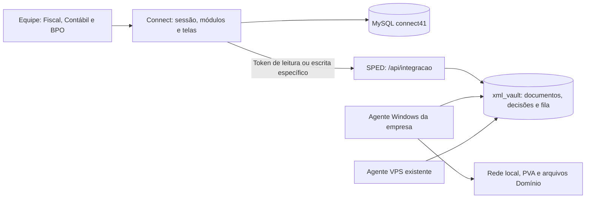

# Migração do backend SPED para o Connect — plano alinhado

Revisão: 14/10/2026. Referência confirmada pelo usuário: `C:\Dev\MIGRACAO-CONNECT-VICTOR.md`, guia escrito por Kauan em 13/10/2026.

Esta revisão substitui a proposta de 13/10, preservada em `PLANO-BACKEND-FISCAL-SPED-PROPOSTA-INICIAL.md` somente como histórico. O guia fornecido foi comparado com o código local; não foi tratado como autorização para publicar, contatar terceiros ou alterar produção.

## 1. Conclusão da comparação

O plano anterior tinha propostas além do escopo da migração: uma API `/v1` independente, reorganização ampla de entidades e fila, mudança de precisão do motor, e exclusão do fluxo Domínio. Seguir aquela proposta integralmente não estaria de acordo com o guia. A implementação segue agora a migração incremental da API existente, preservando comportamento e responsabilidades.

| Ponto | Direção desta revisão |
|---|---|
| Motor | Continua Python. A máquina da empresa e o agente Windows continuam necessários para rede local/PVA/arquivos; preservar a coexistência com agente VPS descrita no guia. Mudança de distribuição exige validação de K0.4. |
| Banco/acervo | Preservar `xml_vault`, os XMLs comprimidos e os dicionários. Não copiar blobs para Prisma nem aplicar ALTER em tabelas grandes fora da janela autorizada. |
| API | Ampliar `/api/integracao` no SPED; manter contrato GET, cursores opacos, CT-e opt-in, erros tipados e isolamento por raiz. |
| Escrita | Credencial separada, autor autenticado, idempotência e auditoria. Token de leitura nunca passa a escrever. |
| Connect | Login, setores, módulos, planos, cadastro e apresentação. Nenhuma credencial do MySQL SPED chega ao Connect. |
| Domínio | Manter entrega/comparação e os lançamentos contábeis da migração. Separar Contábil e BPO conforme o guia. A prévia visual atual precisa ser conciliada com esse destino. |
| Cálculos | Preservar regras atuais. Generalizar BLD, mover estados fiscais e versionar decisões são tarefas do responsável do motor. Precisão decimal no contrato/Connect não autoriza trocar cálculo fiscal protegido. |
| Armazenamento | Escolha futura continua aberta. A migração inicial aproveita o armazenamento existente; nenhuma transferência massiva de acervo é necessária para começar. |
| Validação | Pré-validação interna, evidência do programa oficial e recibo/entrega são marcos distintos. Arquivo baixado deve manter os bytes ISO-8859-1. |
| Publicação | Branches e revisão. Não fazer push para main, migration ou deployment de produção nesta etapa. |

## 2. Arquitetura que será implementada

A API recebe comandos curtos e consulta o resultado no domínio existente. Os agentes executam a fila do SPED; não colocar geração dentro de Server Action, cron HTTP do Connect ou processo de página. O usuário confirmou processamento em máquina da empresa. A disponibilidade e divisão com a VPS serão preservadas até confirmação da topologia pelo responsável.

Não reconstruir a fila nem exigir VPN nova para começar. Recuperação de itens travados e observabilidade devem evoluir a infraestrutura atual. Leases/fencing/snapshots da proposta inicial são melhorias possíveis, não pré-requisitos que autorizam substituir agentes e contratos durante a migração.

## 3. Fronteiras de implementação

Autorizado para o trabalho local: inventário estático, ambiente isolado, ferramentas de teste, CI, preparação de migrations e contratos, clientes/proxies/telas de operação e extração de serviços que preserve comportamento.

Alterações em geração, apuração, classificação, validação, regras e `config/` seguem a lista de revisão do guia. Não reclassificar operações, trocar arredondamento, tirar BLD do motor ou corrigir divergência tributária por conta própria. Um router também pode conter regra protegida; mover código não pode mudar sua semântica.

O ambiente `.env` de produção não será destino de testes. Connect usa `scripts/local/com-banco-local.mjs` e `connect41` em loopback/3307. Para SPED, foi preparado um banco fictício `sped_ci`, separado, com lançador que recusa outro banco/host/usuário antes de importar o motor. A suíte antiga faz SQL no teste de integração; execução direta com `.env` não é considerada isolada.

Não usar `prisma db push`. Preparar migrations em arquivos para revisão; aplicação em produção e janelas de congelamento pertencem ao responsável indicado no guia.

## 4. Ordem de execução e dependências

| Guia | Trabalho | Pode avançar localmente? | Aceite |
|---|---|---|---|
| V0.1 | Verificar ambiente e impedir testes acidentais em produção | Sim; banco descartável não substitui usuário read-only de K0.1 | Connect em loopback e SPED sem credencial real no teste |
| V0.2 | Leitura dos contratos e regressão dos dois repositórios | Sim | Suítes passam em ambiente isolado; falhas preexistentes são registradas |
| V0.3 | Inventário de raiz fixa e tabelas sem escopo explícito | Sim | Relatório por arquivo/linha e revisão semântica pelo responsável |
| V1.1 | CI: tipos/lint/testes/build Connect; regressão e duas imagens SPED | Sim | Workflows de PR sem secrets/deployment; execução remota só após publicação da branch |
| V1.2 | Deployment reproduzível e recuperação da fila | Preparar; execução em VPS depende da janela/aceite | Publicação a partir de Git e agentes operacionais |
| V1.3 | Migrations versionadas SPED | Preparar após inventário do schema | Reproduzir schema em banco vazio, revisar drift e remover DDL de startup com aceite |
| V1.4 | Escrita com token separado, ator, idempotência e auditoria | Estrutura/contratos podem ser preparados | K1.1/D4 definem efeitos e papéis; D6 confirma ativação da credencial |
| V1.5 | Integração cifrada, módulos e permissão nas telas/ações | Após definição das operações | BPO não acessa Fiscal e outro cliente recebe 404 |
| J1.2 | Mapa SPED ↔ Company | Preparar confronto; resolução precisa do responsável | Divergências explícitas e vínculo confirmado |
| V2.1–V2.5 | Execuções, arquivos, cobertura, PDFs e regras | Após endpoints de leitura/operação correspondentes | Mesmos dados/bytes do painel existente e aceite por tela |
| Fase 3 | Telas de decisão Fiscal | Depois das especificações e permissões | Competência inteira comparada ao painel/PVA |
| Fase 4 | Contábil: cinco etapas e carga Domínio | Depois do contrato contábil | Arquivo aceito na Domínio |
| Fase 5 | BPO/Financeiro e eventual DRE | Depois de K0.2/D3 e conferência do responsável | Resultado conferido contra base independente |
| Fase 6 | Integra Contador | Depois do contrato Serpro | Custos, autorizações e fontes confirmados |
| Fase 7 | Desativação das telas antigas | Depois de um mês aceito no Connect, fora do congelamento | Apenas API/health do SPED; nenhuma interrupção das entregas |

Datas do guia são estimativas e dependem do calendário de entregas. Não prometer implantação por data sem o aceite técnico/fiscal correspondente.

## 5. Contrato mínimo de segurança da escrita

- Manter a autorização de leitura por método/prefixo. A nova família de escrita tem validação explícita de token próprio; ausência ou token de leitura não autoriza comando.
- O Connect autentica sessão, escritório ativo, módulo, setor e capacidade em cada ação. O ator enviado ao SPED vem dessa sessão, nunca do formulário.
- `cnpj_raiz` é obrigatório e resolvido a partir das empresas autorizadas. Raiz/identificador de outro cliente recebe 404, preservando o contrato.
- Definir com K1.1 o efeito de cada decisão, sua tabela, necessidade de regeração e papéis autorizados antes de expor a ação.
- Persistir chave de idempotência, fingerprint e resultado. Repetição idêntica recupera o mesmo efeito; mesma chave com corpo diferente é conflito.
- Gravar autor e auditoria junto da mutação. Não confiar somente no `AuditLog` best-effort do Connect.
- Reutilizar serviços extraídos dos POSTs existentes, com `RespostaJson`. Valores monetários novos no contrato precisam de representação decimal explícita; não alterar o encoder legado ou suas regras sem análise de compatibilidade.
- Proxies de download não decodificam/reencodificam TXT. Não carregar arquivos grandes em Server Actions.
- Upload grande vai direto ao SPED com autorização curta e limitada ao upload/raiz/autor, após confirmação D5. Nunca expor o token permanente de escrita ao navegador.
- Não ampliar permissões de portal ou consultar Serpro durante a migração por inferência de acesso à empresa.

## 6. Persistência e evolução sem alteração tributária

Nesta etapa não criar um segundo modelo completo de documentos/cálculos. Novas tabelas técnicas de idempotência, auditoria e migrations podem ser aditivas no SPED, após revisão. No Connect, reutilizar `TenantIntegration`, `SpedSyncState`, `FiscalDocument`, `Company` e os gates existentes.

Versionamento das decisões e sua vinculação a `speds_gerados` é K0.3. O cliente/tela pode mostrar a versão e o aviso de decisões posteriores quando o contrato estiver disponível, mas não fabricar um snapshot retroativo para arquivo legado.

As 400 empresas são o universo cadastral, não a carga concorrente do SPED. A expansão por outras raízes depende da parametrização K1.3. O piloto não oferece operações de outra pessoa jurídica sobre um motor ainda fixo na BLD.

CNPJ alfanumérico permanece item de compatibilidade separado: o guia e os helpers atuais usam dígitos. Não modificar normalização/identificação tributária como efeito colateral desta migração; preparar levantamento e revisão específica antes de anunciar suporte.

## 7. Evidências e estado da preparação

O estado executado desta revisão é registrado em `docs/STATUS-MIGRACAO-SPED-2026-10-14.md`, incluindo comandos, resultados, limitações e itens ainda dependentes do responsável. Os workflows ainda não publicados não equivalem a CI executado no GitHub.

Inventário e ferramentas do SPED ficam em `C:\Dev\sped_generator\docs\INVENTARIO-MIGRACAO-SPED.md` e `docs/TESTES-ISOLADOS-MIGRACAO.md`. O relatório marca categorias preliminares; não transforma todas as tabelas sem uma coluna de CNPJ em defeito comprovado.

Os requisitos da API atual e os guias Next.js locais foram lidos antes das alterações. Esta fundação não aplica migrations, inicia o painel de produção, enfileira geração real ou modifica os arquivos protegidos do motor.
